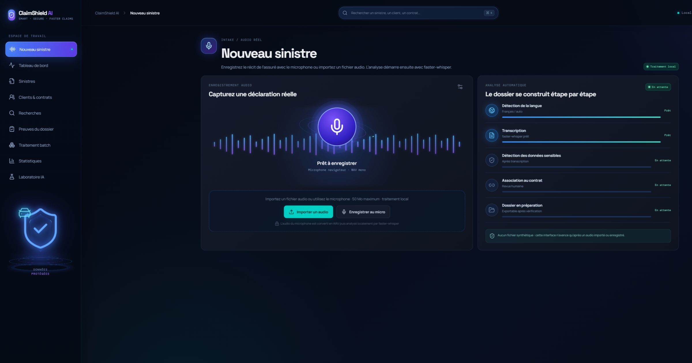
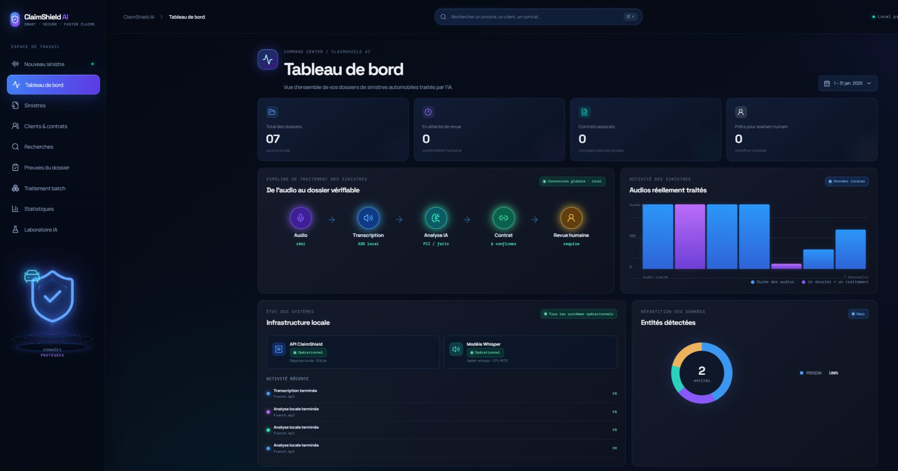
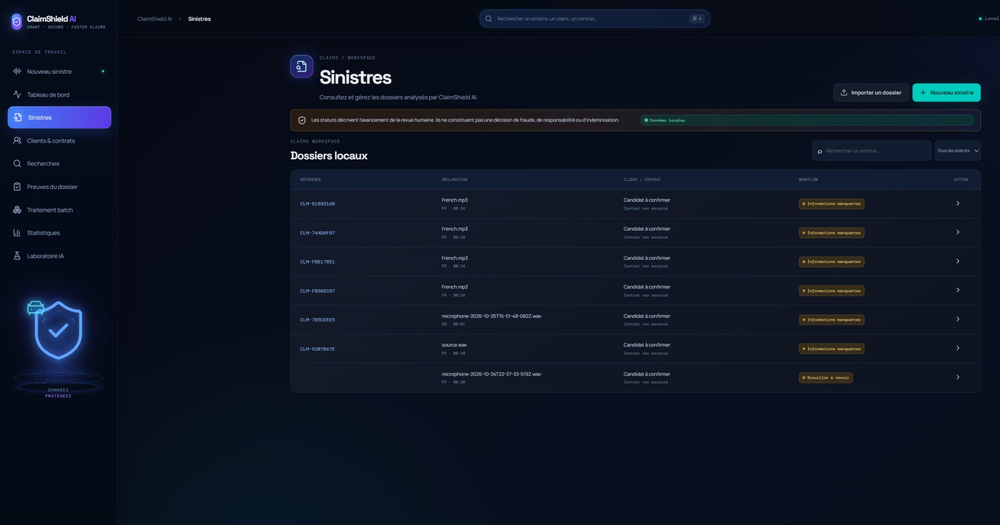
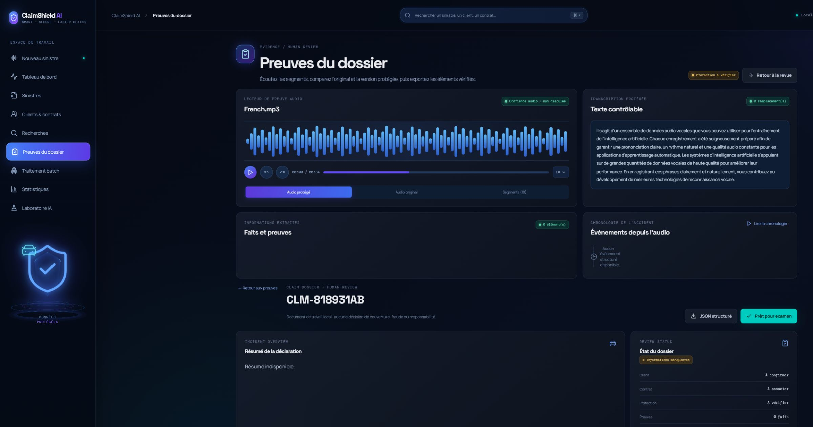
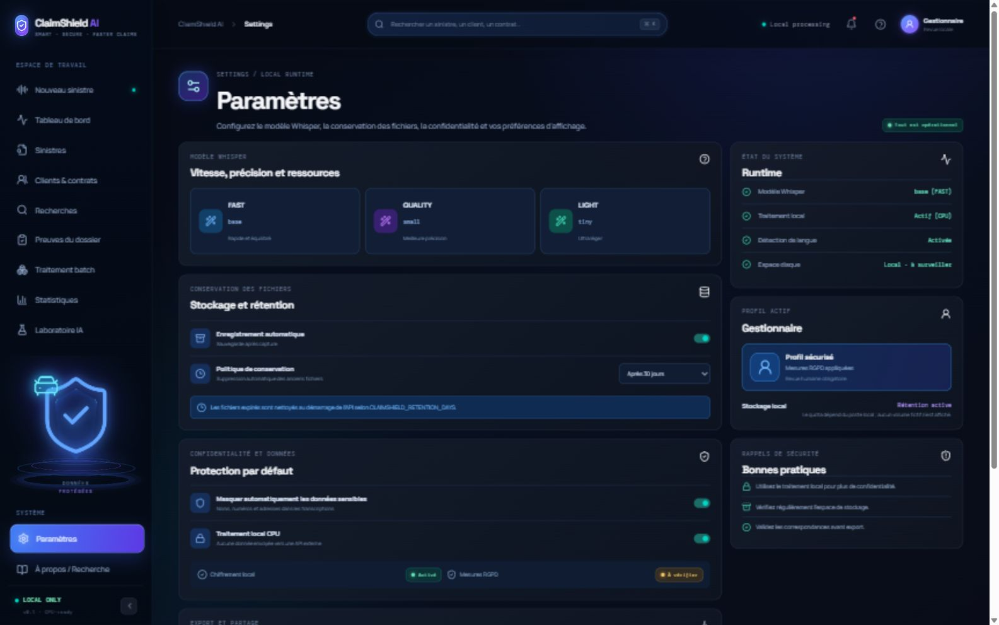
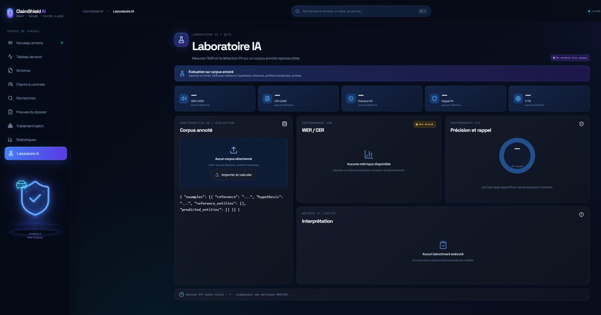
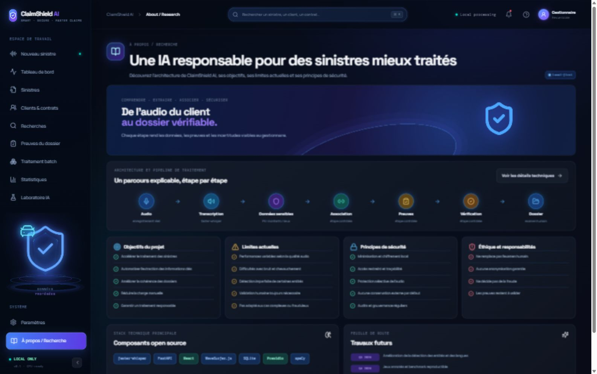

# ClaimShield AI

**Privacy-aware speech intelligence for automotive claims**

ClaimShield AI transforme une déclaration audio en transcription, faits de sinistre, éléments de preuve horodatés et exports protégés. Le traitement est local par défaut : l’audio reste sur le poste, la transcription utilise `faster-whisper` et la revue humaine garde le contrôle des décisions métier.

> Projet portfolio/recherche. ClaimShield AI assiste un gestionnaire ; il ne décide ni fraude, ni responsabilité, ni indemnisation. Le masquage réduit l’exposition des données, mais ne constitue pas une garantie d’anonymisation ou de conformité réglementaire.

## Fonctionnalités

- Enregistrement microphone navigateur ou import d’un fichier audio réel.
- Transcription locale avec `faster-whisper` sur CPU INT8.
- Détection de langue pour le français, l’anglais et l’arabe.
- Détection hybride des données sensibles : identité, téléphone, email, adresse, IBAN, carte, plaque, VIN, contrat et sinistre.
- Extraction de faits automobiles : lieu, date, montant, véhicules, dommages, témoins et type d’incident.
- Alignement des faits avec les mots et segments audio lorsque les timestamps sont disponibles.
- Revue client/contrat avec correspondances explicables et confirmation manuelle.
- Protection audio réelle dans un WAV : silence, bip ou bruit, padding et fade.
- Exports JSON, transcription protégée et provenance du traitement.
- Traitement batch séquentiel pour plusieurs fichiers locaux.
- Laboratoire d’évaluation : WER, CER, précision, rappel et F1 PII sur un corpus annoté fourni par l’utilisateur.

## Captures réelles de l’interface

Ces captures ont été prises sur l’application locale (`http://127.0.0.1:5173`) après traitement d’un audio réel avec `faster-whisper`. Elles ne proviennent pas d’une maquette externe. Elles sont exportées en PNG haute résolution ; cliquez sur une capture pour l’ouvrir à sa taille originale. Les artefacts audio et la base SQLite utilisés pour les produire restent locaux et sont exclus du dépôt.

| Nouveau sinistre | Tableau de bord |
|---|---|
| [](docs/screenshots/01-new-claim.png) | [](docs/screenshots/02-dashboard.png) |

| Sinistres | Preuves du dossier |
|---|---|
| [](docs/screenshots/03-claims.png) | [](docs/screenshots/04-evidence.png) |

| Paramètres |
|---|
| [](docs/screenshots/05-settings.png) |

| Laboratoire IA | À propos / Recherche |
|---|---|
| [](docs/screenshots/06-lab.png) | [](docs/screenshots/07-about.png) |

## Architecture

### Pipeline de traitement


1. L’audio est capturé ou importé localement.
2. Le backend valide le format, la taille, la durée et le décodage.
3. `faster-whisper` produit le texte, la langue et les timestamps.
4. Les règles PII et l’extraction métier identifient les éléments à vérifier.
5. Les faits sont reliés aux segments audio pour conserver une preuve consultable.
6. Le gestionnaire confirme les correspondances et les faits avant export.
7. Le système produit uniquement des sorties protégées et traçables.

### Composants et flux de données


Le diagramme détaille la séparation entre l’interface React, les routes FastAPI, les services d’analyse et la persistance locale. Il indique aussi quelles étapes nécessitent une confirmation humaine et quelles données restent hors Git.

### Protection des données


Les fichiers runtime, la base SQLite et les audios originaux sont conservés dans `data/runtime/`, qui est exclu du dépôt. Les exports sont construits à partir de la transcription protégée et ne doivent pas contenir de valeur sensible en clair.

### Évaluation reproductible


Le laboratoire refuse de fabriquer des métriques. Un corpus d’évaluation doit fournir, pour chaque exemple, une transcription de référence et les entités PII attendues. Un audio réel sans référence mesure le fonctionnement du pipeline, pas le WER.

## Stack technique

| Couche | Technologie |
|---|---|
| Interface | React, TypeScript, Vite, Lucide |
| API | FastAPI, Pydantic |
| ASR | faster-whisper, modèles CTranslate2 |
| Audio | PyAV, NumPy, WAV PCM |
| PII et faits | règles hybrides, alignement par timestamps |
| Persistance | SQLite et fichiers locaux |
| Validation | pytest, TypeScript, build Vite, GitHub Actions |

## Installation Windows

Pré-requis : Python 3.11+, Node.js LTS et PowerShell.

```powershell
.\scripts\setup_windows.ps1
.\scripts\start_backend.ps1
```

Dans un second terminal :

```powershell
.\scripts\start_frontend.ps1
```

Ouvrir ensuite :

- Interface : [http://127.0.0.1:5173](http://127.0.0.1:5173)
- Documentation API : [http://127.0.0.1:8000/docs](http://127.0.0.1:8000/docs)
- Santé de l’API : [http://127.0.0.1:8000/api/health](http://127.0.0.1:8000/api/health)

Le premier traitement télécharge les poids Whisper demandés par `faster-whisper`. Le modèle par défaut est `whisper-base-int8`, adapté au fonctionnement local rapide. `whisper-small-int8` est disponible depuis Paramètres lorsque la priorité est donnée à la qualité.

## Test réel

```powershell
.\.venv-claimshield\Scripts\python.exe -m pytest -q backend/tests
.\.venv-claimshield\Scripts\python.exe -m compileall -q backend
Push-Location frontend
npm ci
npm run build
Pop-Location
```

Dans l’interface :

1. Ouvrir **Nouveau sinistre**.
2. Cliquer sur l’enregistrement microphone ou importer un audio réel.
3. Attendre la transcription locale.
4. Vérifier les entités, les faits et les segments audio.
5. Confirmer manuellement le client et le contrat.
6. Ajouter une région de protection si nécessaire.
7. Générer l’audio protégé et exporter le dossier.

Le test public documenté dans [FINAL_VALIDATION.md](FINAL_VALIDATION.md) a comparé `base-int8` et `small-int8` sur le même fichier français. Le modèle `base-int8` reste le choix par défaut pour ce prototype : il a obtenu WER `29,27 %`, CER `19,83 %`, avec un facteur temps réel de `0,56×` sur cette exécution. Ce résultat ne remplace pas un benchmark annoté représentatif.

## Données et confidentialité

- Ne jamais commiter un audio, une transcription réelle, une base SQLite ou un export de dossier.
- Utiliser uniquement des données fictives ou des enregistrements consentis pendant les essais locaux.
- Les fichiers runtime, secrets, caches, corpus privés, logs et exports sont ignorés par Git.
- Les limites d’upload et la rétention sont configurables avec `CLAIMSHIELD_MAX_UPLOAD_MB`, `CLAIMSHIELD_MAX_AUDIO_MINUTES` et `CLAIMSHIELD_RETENTION_DAYS`.
- Les origines CORS sont configurables avec `CLAIMSHIELD_ALLOWED_ORIGINS`.
- La suppression de rétention est exécutée au démarrage de l’API.

Voir [docs/security.md](docs/security.md) pour les limites et le périmètre de confiance.

## Évaluation et limites

Le laboratoire accepte un JSON de la forme suivante :

```json
{
  "examples": [
    {
      "reference": "texte de référence",
      "hypothesis": "texte produit par le modèle",
      "reference_entities": [],
      "predicted_entities": []
    }
  ]
}
```

Les scores PII ne sont pas affichés comme des vérités générales sans annotations humaines. Les performances varient selon le bruit, les accents, les chevauchements de parole, la langue et la qualité du microphone. Une validation humaine est requise avant tout usage métier.

## Documentation technique

- [Architecture détaillée](docs/architecture.md)
- [Méthodologie d’évaluation](docs/methodology.md)
- [Sécurité et limites](docs/security.md)
- [Audit d’implémentation](PROJECT_AUDIT.md)
- [Validation finale](FINAL_VALIDATION.md)
- [Contribution](CONTRIBUTING.md)

## Licence

MIT — voir [LICENSE](LICENSE). Les modèles, jeux de données et ressources externes conservent leurs licences respectives.
