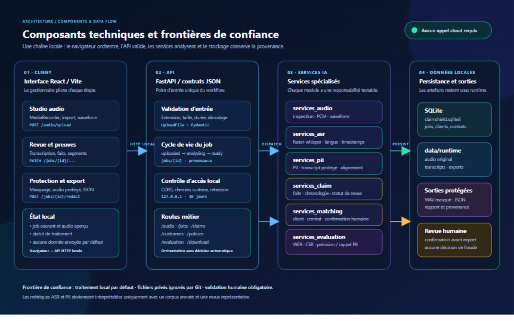
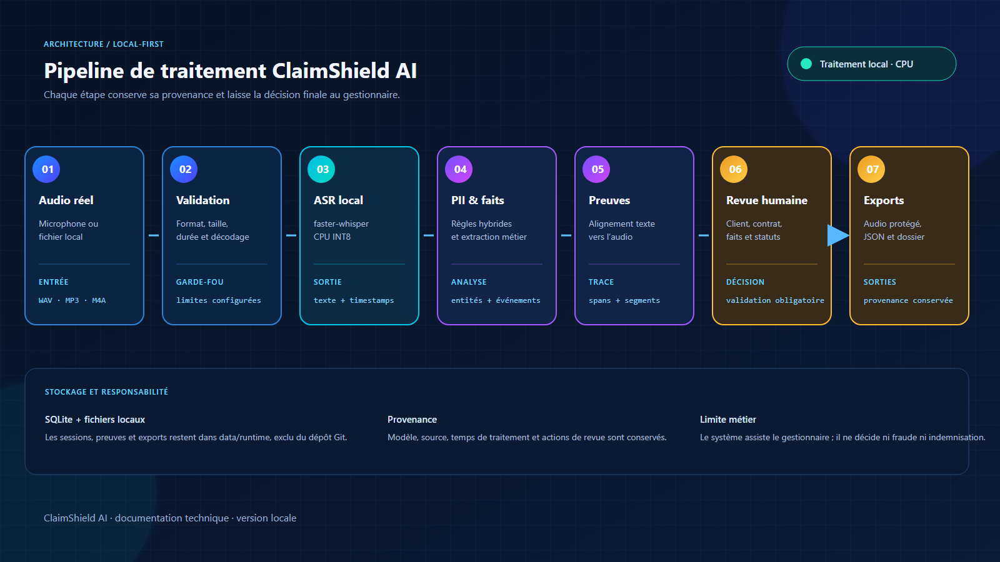
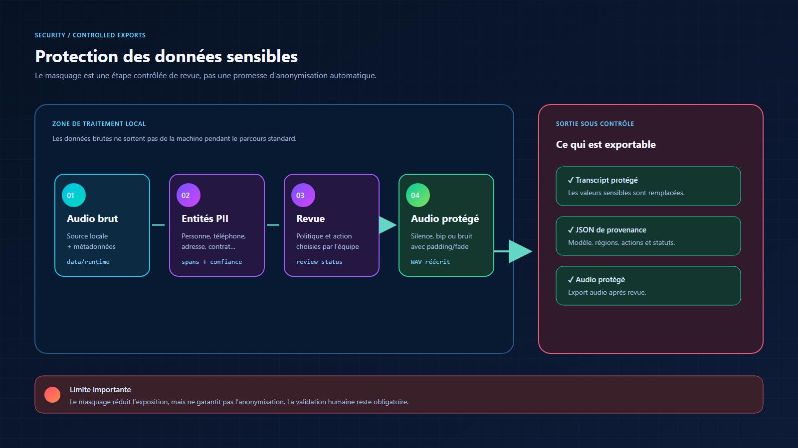
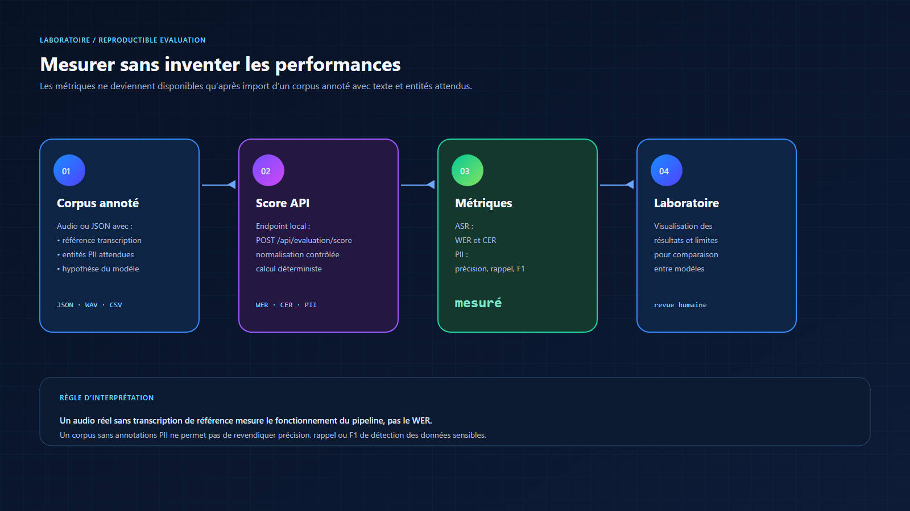

# Architecture

ClaimShield AI est organisé autour d’un pipeline local et vérifiable. Le frontend React orchestre les actions de revue ; FastAPI porte les contrats JSON et les contrôles d’accès aux sessions ; les services backend séparent l’audio, l’ASR, la détection PII, l’extraction métier et la persistance.

## Cartographie des composants

Le système est séparé en quatre zones afin de rendre les responsabilités et les frontières de confiance lisibles :

1. **Client** : React/Vite enregistre ou importe l’audio, affiche les segments et déclenche les actions de revue.
2. **API** : FastAPI valide les fichiers, orchestre le cycle de vie du job, applique CORS et expose les routes JSON.
3. **Services IA** : l’audio, `faster-whisper`, la détection PII, l’extraction de faits, le matching et l’évaluation sont isolés et testables.
4. **Données locales** : SQLite conserve les métadonnées ; `data/runtime/<job_id>` conserve les artefacts temporaires, les audios et les exports protégés.

Les flèches « persist » et « revue humaine » sont volontairement distinctes : l’analyse peut préparer un dossier, mais une personne doit contrôler les faits et confirmer les correspondances avant de produire une sortie métier.

## Vue d’ensemble

Le chemin nominal est :

1. Capture ou import d’un audio réel.
2. Validation du format, de la taille, de la durée et du décodage.
3. Transcription locale avec `faster-whisper` et détection de langue.
4. Détection des données sensibles et extraction de faits automobiles.
5. Alignement des faits avec les mots et segments audio disponibles.
6. Correspondance client/contrat et revue humaine explicable.
7. Génération des sorties protégées après vérification.

## Protection et stockage

Les fichiers de session sont placés sous `data/runtime/<job_id>`. La base `claimshield.sqlite3` conserve les métadonnées nécessaires au workflow local ; les audios et exports ne sont pas des fixtures du dépôt. Le nettoyage au démarrage applique `CLAIMSHIELD_RETENTION_DAYS`.

Les fonctions d’export utilisent la transcription protégée et filtrent les chemins locaux. La redaction WAV réécrit les samples de régions définies, avec une méthode configurable et une durée conservée. Cela réduit l’exposition mais ne neutralise pas toutes les possibilités de ré-identification.

## Évaluation

Le laboratoire accepte un corpus annoté fourni par l’utilisateur et calcule :

- WER et CER pour l’ASR ;
- précision, rappel et F1 pour les entités PII ;
- des résultats par corpus importé, sans inventer de score global.

Un audio réel sans référence humaine valide le fonctionnement du pipeline, mais ne suffit pas pour mesurer le WER. De même, un corpus sans entités PII attendues ne permet pas de conclure sur la précision ou le rappel de la détection.

## Modules

| Module | Responsabilité |
|---|---|
| `backend/app/main.py` | API, workflow des jobs, export et rétention |
| `backend/app/services_audio.py` | inspection, chargement et protection WAV |
| `backend/app/services_asr.py` | chargement et transcription `faster-whisper` |
| `backend/app/services_pii.py` | entités sensibles et transcript protégé |
| `backend/app/services_claim.py` | faits, chronologie et dossier de sinistre |
| `backend/app/services_matching.py` | correspondances locales client/contrat |
| `backend/app/services_evaluation.py` | métriques WER, CER et PII |
| `backend/app/storage.py` | SQLite, catalogue local et persistance |
| `frontend/src/screens.tsx` | écrans métier et interactions principales |
| `frontend/src/claim-dashboard.tsx` | workspace dossier, matching et preuves |

## Périmètre de production

Une version production ajouterait une authentification, une autorisation par rôle, un KMS, des journaux externalisés, une file de traitement bornée et une politique de conservation validée juridiquement. Ces éléments sont volontairement identifiés comme travaux futurs ; ils ne sont pas présentés comme déjà disponibles.
